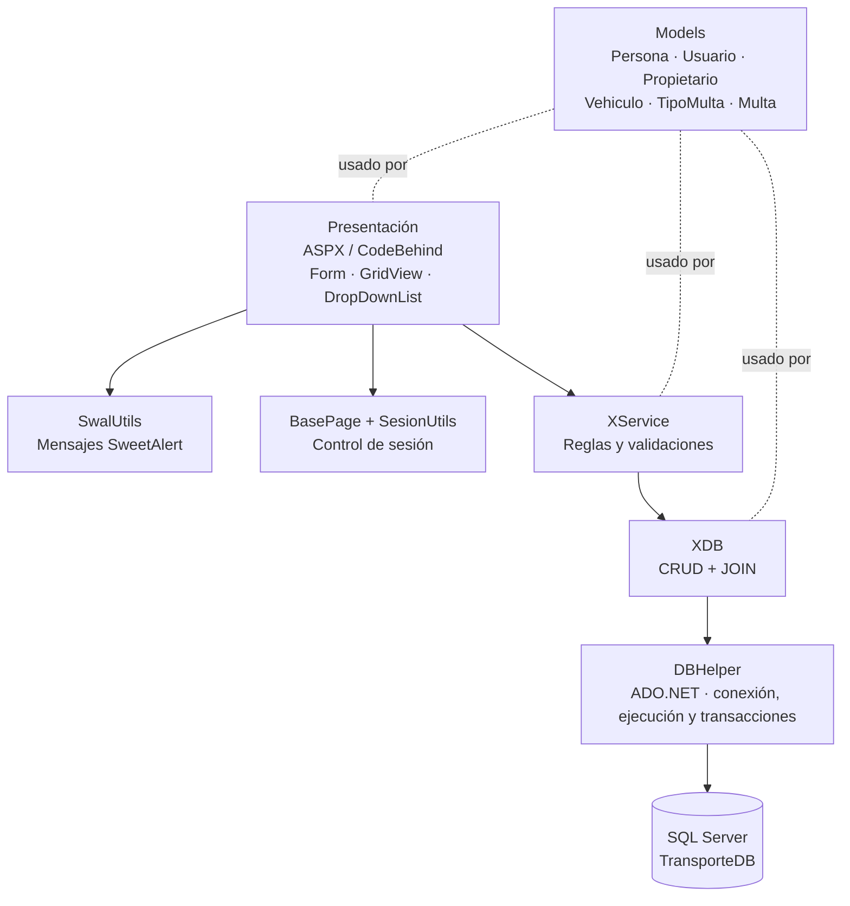
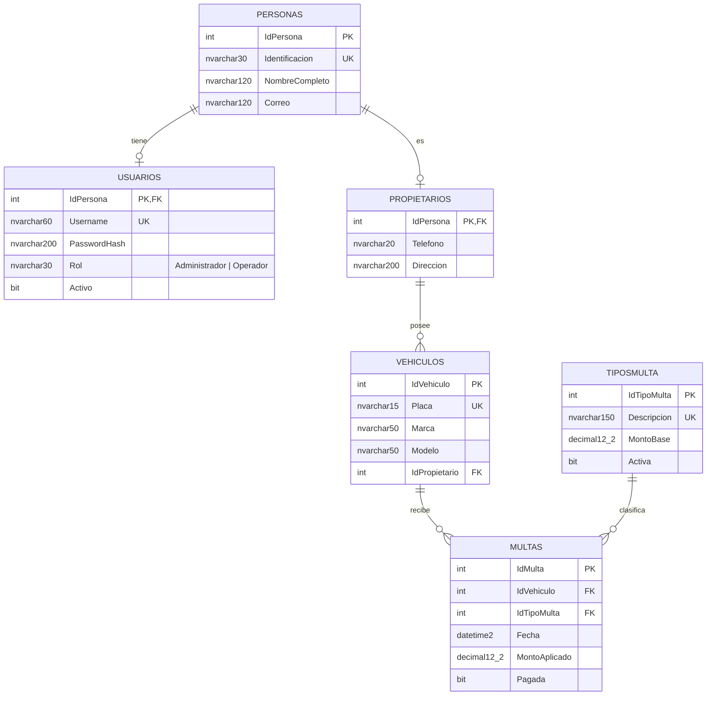
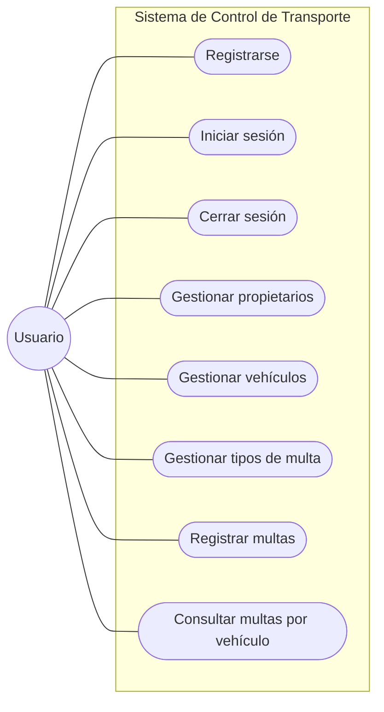

# Caso Transporte · Programación 3 (VB.NET Web)

Aplicación web en **ASP.NET Web Forms con Visual Basic .NET** para administrar propietarios, vehículos, tipos de multa y multas, con **ADO.NET**, **SQL Server**, **sesiones** y **arquitectura en capas**.

El proyecto se entrega con el **Login y el Registro funcionando**. A partir de esa base, cada grupo desarrolla un módulo siguiendo el mismo patrón de capas.

---

## 1. Problema por resolver

Una pequeña empresa de transporte necesita una aplicación web para administrar propietarios, vehículos y multas. Hoy la información está dispersa o se lleva a mano, por lo que es difícil saber qué vehículos tiene cada propietario y qué multas tiene cada vehículo.

## 2. Pregunta orientadora

¿Cómo puede una aplicación web gestionar propietarios, vehículos y multas, manteniendo las relaciones entre entidades y controlando el acceso mediante sesiones de usuario?

## 3. Objetivo general

Desarrollar una aplicación web en ASP.NET Web Forms con Visual Basic .NET que gestione propietarios, vehículos, usuarios y multas, aplicando ADO.NET, SQL Server, sesiones y arquitectura en capas.

## 4. Objetivos específicos

| # | Objetivo | Responsable |
|---|----------|-------------|
| 1 | Autenticar usuarios con usuario, contraseña (hash) y sesión, y permitir el registro de nuevos usuarios. | Base (docente) ✅ |
| 2 | Registrar, listar, editar y eliminar propietarios. | Grupo A |
| 3 | Registrar, listar, editar y eliminar vehículos asociados a un propietario. | Grupo B |
| 4 | Administrar el catálogo de tipos de multa (monto base y estado activo/inactivo). | Grupo C |
| 5 | Registrar multas asociadas a un vehículo y a un tipo de multa, y consultarlas por vehículo. | Grupo D |
| 6 | Mostrar información relacionada mediante consultas con `JOIN`. | Todos |
| 7 | Respetar la separación en capas: presentación, servicio, datos y utilidades. | Todos |

En este documento, **"gestionar" significa CRUD completo**: registrar, listar, editar y eliminar (o desactivar, cuando la regla lo indique).

---

## 5. Puesta en marcha

1. **Clonar** el repositorio y abrir `3Q26-CasoTransporte.slnx` en Visual Studio.
2. **Crear la base de datos.** En SQL Server Management Studio, ejecutar los scripts **en este orden**:

   | Orden | Script | Qué hace |
   |---|---|---|
   | 1 | `Database/00_base/01_create_db.sql` | Crea `TransporteDB` |
   | 2 | `Database/01_personas_usuarios/01_schema.sql` | Tablas `Personas` y `Usuarios` |
   | 3 | `Database/01_personas_usuarios/02_seed.sql` | Usuarios de prueba |
   | 4 | `Database/02_transporte/01_schema.sql` | Tablas `Propietarios`, `Vehiculos`, `TiposMulta`, `Multas` |
   | 5 | `Database/02_transporte/02_seed.sql` | Datos de prueba de los módulos |

   Todos los scripts se pueden ejecutar más de una vez sin duplicar datos.
   Si ya tenía una `TransporteDB` creada con scripts anteriores, elimínela (`DROP DATABASE TransporteDB`) y ejecute todo de nuevo.

3. **Configurar la conexión (cada integrante, en su computadora).**
   En la carpeta del proyecto (junto a `Web.config`), copiar `ConnectionStrings.example.config` como **`ConnectionStrings.config`** y cambiar `Server` por su instancia de SQL Server.
   - Ese archivo está en `.gitignore`: **no se sube** al repositorio, así no se pisan las conexiones entre compañeros ni se publican contraseñas.
   - **No** agregue cadenas de conexión en `Web.config`. El nombre `ConexionTransporteDB` no se cambia porque lo usa `DBHelper`.

4. **Ejecutar** (F5) e ingresar con un usuario de prueba:

   | Usuario | Contraseña | Rol | Uso |
   |---|---|---|---|
   | `juan` | `Clave123` | Administrador | Ingreso normal |
   | `maria` | `Clave123` | Operador | Ingreso normal |
   | `carlos` | `Clave123` | Operador | **Inactivo**: debe rechazar el ingreso |

---

## 6. Arquitectura



### Reglas por capa

| Capa | Carpeta | Puede | No puede |
|---|---|---|---|
| Presentación | raíz y `Pages/` | Leer el formulario, llamar a **un** Service, mostrar mensajes con `SwalUtils`, llenar GridView/DropDownList | Escribir SQL, usar `DBHelper` o clases `XDB` |
| Servicio | `Services/` | Validar, aplicar reglas de negocio, llamar a una o varias clases `XDB`, abrir transacciones | Usar `SwalUtils`, `Session`, controles o `Response` |
| Datos | `Database/*.vb` | Escribir SQL **con parámetros** y convertir filas a modelos | Validar reglas, mostrar mensajes |
| Utilidades | `Utils/` | Conexión (`DBHelper`), sesión (`SesionUtils`, `BasePage`), mensajes (`SwalUtils`), contraseñas (`PasswordHasher`) | Ser modificadas por los grupos (ver §8) |
| Modelos | `Models/` | Propiedades y constructores | Lógica de base de datos |

### Convenciones obligatorias

- **SQL siempre parametrizado** (`@Parametro` + `SqlParameter`). Nunca concatenar valores escritos por el usuario.
- **Errores de validación:** el Service lanza `ArgumentException("mensaje para el usuario")`. La página los atrapa así:

  ```vb
  Try
      _vehiculoService.Guardar(vehiculo)
      SwalUtils.ShowSuccess(Me, "Vehículo guardado.")
  Catch ex As ArgumentException
      SwalUtils.ShowWarning(Me, ex.Message)
  Catch ex As Exception
      SwalUtils.ShowError(Me, "Ocurrió un error: " & ex.Message)
  End Try
  ```

- **Páginas protegidas** heredan de `BasePage` (no de `Page`). Sin sesión, redirigen al Login. El usuario conectado está en `UsuarioActual`.
- **Redirecciones dentro de un `Try`:** usar `Response.Redirect(url, False)` seguido de `Context.ApplicationInstance.CompleteRequest()`.
- **Nombres:** `XService`, `XDB`, modelo en singular (`Vehiculo`) y página en plural (`Pages/Vehiculos.aspx`).
- **Herencia de Persona:** `Usuario` y `Propietario` heredan de `Persona` porque sus tablas comparten `IdPersona` (relación 1:1).

### Ejemplo de referencia: Login y Registro

Para resolver su módulo, revise cómo está hecho el flujo completo:

| Capa | Archivo | Qué mirar |
|---|---|---|
| Presentación | `Login.aspx(.vb)`, `Registro.aspx(.vb)` | Armar el modelo desde el formulario, `Try/Catch` con `SwalUtils` |
| Servicio | `Services/UsuarioService.vb` | Validaciones, reutilizar `PersonaService.ValidarPersona`, **transacción** Persona + Usuario |
| Datos | `Database/UsuarioDB.vb`, `Database/PersonaDB.vb` | Consulta con `INNER JOIN`, `INSERT ... OUTPUT INSERTED.Id`, parámetro opcional `tran` |
| Utilidades | `Utils/DBHelper.vb` | `ExecuteQuery`, `ExecuteNonQuery`, `ExecuteScalar`, `ExecuteInTransaction` |

El **Grupo A** necesita exactamente el mismo patrón de transacción para crear Persona + Propietario.

---

## 7. Modelo de datos



Decisiones de diseño que deben explicar en la documentación:

- **Especialización 1:1:** `Usuarios` y `Propietarios` usan `IdPersona` como PK y FK. Una misma persona puede ser usuario y propietario (en los datos de prueba, Juan lo es).
- **`MontoAplicado` y `MontoBase`:** la multa guarda el monto vigente al registrarse; si el tipo de multa cambia de monto, las multas anteriores no se alteran.
- **`Activa` en TiposMulta:** un tipo con multas asociadas no se borra, se desactiva, y deja de aparecer al registrar multas nuevas.
- **Índices únicos** en `Identificacion`, `Username`, `Placa` y `Descripcion`: la base de datos impide duplicados aunque falle la validación del Service.
- **Contraseñas:** se guardan con PBKDF2-SHA256, sal aleatoria y 100 000 iteraciones (`Utils/PasswordHasher.vb`), nunca en texto plano.

---

## 8. Trabajo por grupos

### Qué entrega la base (no se modifica sin coordinar con el docente)

`Utils/*` · `Login` · `Registro` · `Site.Master` · `Default.aspx` · `Models/Persona.vb` · `Models/Usuario.vb` · `PersonaDB` · `UsuarioDB` · `PersonaService` · `UsuarioService` · scripts SQL

Si un grupo necesita un cambio en la base, lo solicita al docente; no lo hace en su rama.

### Módulos

Cada módulo ya tiene su página creada en `Pages/`, protegida con `BasePage` y enlazada en el menú. También están creados los modelos y las tablas con datos de prueba, así que **ningún grupo depende de que otro termine**.

| Grupo | Módulo | Archivos a crear o completar | Requisitos mínimos |
|---|---|---|---|
| **A** | Propietarios | `Database/PropietarioDB.vb`, `Services/PropietarioService.vb`, `Pages/Propietarios.aspx` | CRUD. Registrar crea **Persona + Propietario en una transacción**. Listado con `JOIN` a Personas. No eliminar un propietario con vehículos. |
| **B** | Vehículos | `Database/VehiculoDB.vb`, `Services/VehiculoService.vb`, `Pages/Vehiculos.aspx` | CRUD. `DropDownList` de propietarios. Placa única. Listado con `JOIN` que muestre el nombre del propietario. No eliminar un vehículo con multas. |
| **C** | Tipos de multa | `Database/TipoMultaDB.vb`, `Services/TipoMultaService.vb`, `Pages/TiposMulta.aspx` | CRUD. Monto base mayor que 0. Descripción única. Desactivar en lugar de eliminar cuando tenga multas. |
| **D** | Multas | `Database/MultaDB.vb`, `Services/MultaService.vb`, `Pages/Multas.aspx` | Registrar multa con `DropDownList` de vehículos y de tipos **activos**. `MontoAplicado` toma el `MontoBase` vigente. Marcar como pagada. **Consulta de multas por vehículo** con `JOIN` (Multas, Vehiculos, Propietarios, Personas, TiposMulta). |

**Opcional (puntos extra):** restringir Tipos de multa a usuarios con rol Administrador usando `SesionUtils.EsAdministrador`.

### Flujo de trabajo con Git

1. Partir de la rama del docente: `git checkout feature/login && git pull`.
2. Crear la rama del grupo: `git checkout -b feature/propietarios` (o `vehiculos`, `tipos-multa`, `multas`).
3. Hacer commits pequeños y frecuentes. **No subir** `ConnectionStrings.config`, `bin/`, `obj/` ni `.vs/`.
4. Al terminar, abrir un Pull Request hacia la rama del docente.
5. El único archivo compartido que todos modifican es el `.vbproj` (Visual Studio agrega ahí los archivos nuevos). Si hay conflicto, conservar **todas** las líneas `<Compile Include=...>` y `<Content Include=...>` de ambos lados.

---

## 9. Diagrama de casos de uso



Cada grupo amplía el diagrama con los casos de uso de su módulo (por ejemplo: editar, desactivar, marcar como pagada).

---

## 10. Documentación del análisis

**Extensión:** máximo **2 páginas** de texto. Los diagramas y las capturas van en **anexos** y no cuentan para el límite.

1. **Problema, pregunta y objetivos** del módulo del grupo, relacionados con los del caso (§1 a §4).
2. **Diseño:** diagrama de casos de uso del módulo, parte del ER que utiliza y ubicación de sus clases en la arquitectura.
3. **Explicación técnica breve:**
   - cómo se relacionan las tablas que usa el módulo (llaves y restricciones);
   - cómo se controla el acceso (sesión, `BasePage`);
   - qué hace cada capa en su módulo y por qué la página no accede directo a la base de datos;
   - qué consulta `JOIN` implementaron y qué información muestra;
   - al menos una decisión de diseño de §7 explicada con sus palabras.
4. **Evidencias de prueba** (anexo), con captura y resultado esperado:

   | Tipo | Prueba |
   |---|---|
   | Éxito | Inicio de sesión correcto |
   | Éxito | Registro, listado y edición en su módulo |
   | Éxito | Consulta con información relacionada mediante `JOIN` |
   | Error | Acceso a la página del módulo sin sesión → redirige al Login |
   | Error | Dato duplicado (placa, identificación o descripción) → mensaje de advertencia |
   | Error | Campo obligatorio vacío o valor inválido → mensaje de advertencia |
   | Error | Eliminación bloqueada por una relación (por ejemplo, propietario con vehículos) |

---

## 11. Criterios de evaluación (sugeridos)

| Criterio | Peso |
|---|---|
| Funcionalidad del módulo (requisitos mínimos de §8) | 35 % |
| Respeto de la arquitectura en capas y de las convenciones de §6 | 20 % |
| Base de datos: consultas parametrizadas y `JOIN` correctos | 15 % |
| Validaciones y manejo de errores con mensajes claros | 10 % |
| Documentación y evidencias de prueba | 15 % |
| Uso de Git: commits del grupo y Pull Request sin conflictos | 5 % |
